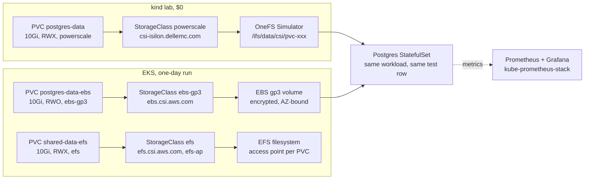

# PowerScale CSI on Kubernetes, with an EKS runtime

[](https://github.com/chanawh/pscale-csi-kubernetes/actions/workflows/ci.yml)

Project 2, after the NAS-to-AWS migration factory. Project 1
moved files off PowerScale into the cloud. This one gives
Kubernetes a real disk, first on PowerScale and now also on
AWS, and proves the data survives the things that kill pods.

Two runtimes, one project:

- **kind + PowerScale CSI ($0).** Postgres runs on a
  PowerScale PVC via Dell's CSI driver against the OneFS
  Simulator. Four drills: snapshot and restore, clone,
  volume expansion 10 to 20 GiB, and killing a worker node
  to show the volume follows the pod.
- **EKS + AWS CSI (about $4.50 for one day).** The same
  Postgres workload on a real EKS cluster built with
  Terraform: EBS gp3 (block, ReadWriteOnce), EFS (file,
  ReadWriteMany), EKS Pod Identity for the CSI controllers,
  and kube-prometheus-stack observability. Drills: EBS
  snapshot and restore, expand 10 to 20 GiB, and a timed
  node drain that measures pod recovery instead of
  estimating it.

**Honest limits, up front:** we use Dell's driver and AWS's
drivers, we do not write any. The kind cluster's storage is
a Simulator. The EKS Terraform is validated (fmt/validate,
17 Python tests, Helm renders), not yet applied from this
build environment, which has no AWS account and no Docker;
kind runs in CI and on your machine, and the EKS run is a
one-day operator run, destroyed the same day. This is a lab
project, labelled as one. The point is that the same
workload runs against three storage systems and the drills
prove what survives.



## Who built this, and why

Andrew Chan, Technical Support Engineer II at Dell
Technologies since December 2018, escalation point for
150+ enterprise Dell PowerScale (OneFS) environments and
1,400+ high-severity incidents, with 15+ Python, Bash and
PowerShell automation tools and 20+ runbooks built on the
job. Certifications held: AWS Solutions Architect
Professional, CKA, Terraform Associate, RHCE, CCNA.

This project exists because support work alone does not
prove build skill. It takes the storage a PowerScale TSE
supports every day, NFS exports, SmartQuotas, snapshots,
node failures, puts Kubernetes on top of it with Dell's own
CSI driver, then runs the same workload on EKS with AWS's
CSI drivers so the comparison is measured, not asserted.
Target roles: Cloud Support Engineer, Cloud Operations,
Storage and Platform Engineer.

## What this proves for a cloud role

| PowerScale TSE experience | Cloud proof in this repo |
|---|---|
| NFS exports on OneFS | CSI node plugin mounts NFS exports on every worker; EFS access points on EKS |
| SmartQuotas | Driver sets a quota per volume, expansion grows it in place; EBS expansion via resizer on EKS |
| PowerScale snapshots | CSI VolumeSnapshot, restore PVC, clone PVC; EBS snapshot/restore on EKS |
| Node failure on a cluster | kind drill (`docker stop`) and EKS drill (`kubectl drain`, timed): pod reschedules, volume follows, data survives |
| OneFS Platform API | CSI controller creates directories, exports, quotas through the API |
| CKA, Kubernetes operations | kind cluster, Helm installs, StorageClasses, StatefulSet, CI dry-run in a real cluster |
| AWS Solutions Architect Professional | EKS cluster + node group in Terraform, EBS/EFS CSI addons, Pod Identity least-privilege roles, KMS secrets encryption, CloudWatch control-plane logs |
| Observability (exporter work) | kube-prometheus-stack on EKS: node, kube-state, PVC/pod metrics during the drills |

**For hiring managers and interviewers:** start at
`docs/INTERVIEW_GUIDE.md`. It has the STAR bullets, the
30-second pitch, and the questions you will be asked, with
answers. CI runs on every push: 19 manifest/Terraform/monitoring
tests, Terraform fmt/validate, Helm template, and a real
kind cluster where the manifests are applied dry-run, see
`.github/workflows/ci.yml`.

## What is in here

| Path | What it is |
|---|---|
| `k8s/` | PowerScale path: StorageClass x2, VolumeSnapshotClass, PVC, Postgres StatefulSet + Service + Secret, snapshot, restore PVC, clone PVC, test Job |
| `k8s/eks/` | EKS path: EBS gp3 + EFS StorageClasses, EBS snapshot class, EBS Postgres PVC + StatefulSet, EFS shared PVC, EBS snapshot + restore |
| `helm/` | Values for dell/csi-isilon 2.18.1, kube-prometheus-stack observability values, plus isilon-creds.yaml.example (never commit the filled-in file) |
| `terraform/` | EKS cluster + node group + EBS/EFS CSI addons + Pod Identity + EFS filesystem + KMS, gated off by `enable_eks = false` |
| `scripts/` | kind path: setup_kind, install_driver, run_demo, and 4 standalone drills |
| `scripts/eks/` | EKS path: deploy_eks (apply + addons + manifests + observability), run_eks_demo (timed drills), destroy_eks (PVCs first, then destroy, orphan check) |
| `python/tests/` | 19 checks on the manifests, Helm values, Terraform, scripts, and monitoring, no cluster needed |
| `monitoring/` | Grafana dashboard (8 panels) + PrometheusRule (5 alerts) as code, validated in CI, loaded on the EKS run |
| `docs/ONEFS_CSI_SETUP.md` | OneFS side: base path, SmartQuotas, NFS, networking |
| `docs/INTERVIEW_GUIDE.md` | STAR bullets, 30-second pitch, interview Q&As |
| `docs/REAL_EKS_ONE_DAY.md` | One real EKS run, about $4.50 for a day, step by step with destroy checklist |

**System design:** `docs/SYSTEM_DESIGN.md` covers
requirements, scale and capacity, the data model,
failure modes, security, observability, cost, tradeoffs,
and what to do next at real scale. `docs/adr/` holds the
six architecture decisions, each with context, decision,
and consequences. `SECURITY.md` states what is safe and
what is lab-only. That is the 2026-competitive part: not
just manifests that apply, but a design a reviewer can
argue with, and evidence that the argument was thought through.

## Run it: kind + PowerScale ($0)

```sh
# 1. OneFS: follow docs/ONEFS_CSI_SETUP.md, then fill in helm/isilon-creds.yaml
# 2. Cluster
bash scripts/setup_kind.sh
# 3. Driver (Dell's, installed with Helm)
bash scripts/install_driver.sh
# 4. Full demo
bash scripts/run_demo.sh
```

## Run it: EKS + AWS CSI (one day, then destroy)

```sh
# Requires: aws CLI configured, terraform, kubectl, helm, envsubst
bash scripts/eks/deploy_eks.sh    # Terraform apply, addons, manifests, observability
bash scripts/eks/run_eks_demo.sh  # write row, snapshot, expand, timed node drain, verify
bash scripts/eks/destroy_eks.sh   # PVCs first, then terraform destroy, orphan check
```

Full walkthrough, cost table, and evidence checklist:
`docs/REAL_EKS_ONE_DAY.md`.

## The drills

PowerScale path (kind):

1. **Snapshot and restore.** `scripts/drills/snapshot_restore.sh` snapshots the Postgres PVC, restores a new PVC from it, and proves the test row is back.
2. **Clone.** `scripts/drills/clone.sh` creates a second, independent PVC from the original, for testing without touching it.
3. **Expand.** `scripts/drills/expand.sh` grows the PVC from 10 to 20 GiB in place, no recreate, because `allowVolumeExpansion: true` is set on the StorageClass.
4. **Node failure.** `scripts/drills/node_failure.sh` stops the kind node running Postgres with `docker stop`, waits for the pod to reschedule on the other worker, and proves the row survived.

EKS path (`scripts/eks/run_eks_demo.sh`): write the row,
EBS snapshot and restore, expand 10 to 20 GiB, then
`kubectl drain` the Postgres node and time how long the
pod takes to be Ready on the surviving node. That measured
number replaces any estimate. The row must read back after
every step, same as on PowerScale.

## Verified live

- Python tests: 19/19 pass (9 PowerScale + 8 EKS upgrade + 2 monitoring)
- Terraform fmt and validate: clean (EKS, addons, Pod Identity, EFS, KMS)
- Helm template, dell/csi-isilon 2.18.1: renders 18 objects, driver name `csi-isilon.dellemc.com` present; kube-prometheus-stack with `helm/observability-values.yaml`: renders 113 objects
- Scripts: `bash -n` clean, including `scripts/eks/`
- Not run live here: kind (no Docker in this VM), the driver installs, Postgres, the drills, or any EKS apply (no AWS account in this VM). Those run on your machine (kind + OneFS Simulator) and on your AWS account for one day (EKS). In CI the manifests are applied dry-run against a real kind API server.
