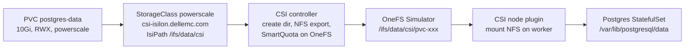

# PowerScale CSI on Kubernetes

[](https://github.com/chanawh/pscale-csi-kubernetes/actions/workflows/ci.yml)

Project 2, after the NAS-to-AWS migration factory. Project 1
moved files off PowerScale into the cloud. This one gives
Kubernetes a real disk on PowerScale, and proves it survives
the things that kill pods.

Postgres runs on a PowerScale PVC, via Dell's CSI driver.
Four drills prove it: snapshot and restore, clone, volume
expansion from 10 to 20 GiB, and killing a worker node to
show the volume follows the pod.

**Cost: $0.** kind on your machine, OneFS Simulator as the
backend, Dell's driver installed with Helm. No AWS account,
no cloud bill. One real EKS run is about $4.50 for a day,
see `docs/REAL_EKS_ONE_DAY.md`.

**Honest limits, up front:** we use Dell's driver, we do
not write one. The cluster is kind, the storage is a
Simulator, and the EKS Terraform was validated only, not
applied. kind did not run live in this VM, it has no Docker;
kind runs in CI and on your machine. The manifests were
validated live here by Python tests, Terraform validate,
and Helm template. This is a lab project, labelled as one,
and the manifests are the same ones a real EKS run uses.



## Who built this, and why

Andrew Chan, Technical Support Engineer II at Dell
Technologies since December 2018, escalation point for
150+ enterprise Dell PowerScale (OneFS) environments and
1,400+ high-severity incidents, with 15+ Python, Bash and
PowerShell automation tools and 20+ runbooks built on the
job. Certifications held: AWS Solutions Architect
Professional, CKA, Terraform Associate, RHCE, CCNA.

This project exists because support work alone does not
prove build skill. It takes the storage a PowerScale TSE
supports every day, NFS exports, SmartQuotas, snapshots,
node failures, and puts Kubernetes on top of it with
Dell's own CSI driver, proven by four drills. Target
roles: Cloud Support Engineer, Cloud Operations,
Storage and Platform Engineer.

## What this proves for a cloud role

| PowerScale TSE experience | Cloud proof in this repo |
|---|---|
| NFS exports on OneFS | CSI node plugin mounts NFS exports on every worker |
| SmartQuotas | Driver sets a quota per volume, expansion grows it in place |
| PowerScale snapshots | CSI VolumeSnapshot, restore PVC, clone PVC |
| Node failure on a cluster | Node failure drill: pod reschedules, volume follows, data survives |
| OneFS Platform API | CSI controller creates directories, exports, quotas through the API |
| CKA, Kubernetes operations | kind cluster, Helm install, StorageClasses, StatefulSet, CI dry-run in a real cluster |

**For hiring managers and interviewers:** start at
`docs/INTERVIEW_GUIDE.md`. It has the STAR bullet, the
30-second pitch, and the ten questions you will be asked,
with answers. CI runs on every push: 9 manifest tests,
Terraform fmt/validate, Helm template, and a real kind
cluster where the manifests are applied dry-run, see
`.github/workflows/ci.yml`.

## What is in here

| Path | What it is |
|---|---|
| `k8s/` | StorageClass x2, VolumeSnapshotClass, PVC, Postgres StatefulSet + Service + Secret, snapshot, restore PVC, clone PVC, test Job |
| `helm/` | Values for dell/csi-isilon 2.18.1, plus isilon-creds.yaml.example (never commit the filled-in file) |
| `terraform/` | EKS cluster + node group, gated off by `enable_eks = false` |
| `scripts/` | setup_kind, install_driver, run_demo, and 4 standalone drills |
| `python/tests/` | 9 checks on the manifests, Helm values, and kind config, no cluster needed |
| `docs/ONEFS_CSI_SETUP.md` | OneFS side: base path, SmartQuotas, NFS, networking |
| `docs/INTERVIEW_GUIDE.md` | STAR bullet, 30-second pitch, 10 interview Q&As |
| `docs/REAL_EKS_ONE_DAY.md` | One real EKS run, about $4.50 for a day |

**System design:** `docs/SYSTEM_DESIGN.md` covers
requirements, scale and capacity, the data model,
failure modes, security, observability, cost, tradeoffs,
and what to do next at real scale. `docs/adr/` holds the
five architecture decisions, each with context, decision,
and consequences. `SECURITY.md` states what is safe and
what is lab-only. That is the 2026-competitive part: not
just manifests that apply, but a design a reviewer can
argue with, and evidence that the argument was thought through.

## Run it

```sh
# 1. OneFS: follow docs/ONEFS_CSI_SETUP.md, then fill in helm/isilon-creds.yaml
# 2. Cluster
bash scripts/setup_kind.sh
# 3. Driver (Dell's, installed with Helm)
bash scripts/install_driver.sh
# 4. Full demo
bash scripts/run_demo.sh
```

## The four drills

1. **Snapshot and restore.** `scripts/drills/snapshot_restore.sh` snapshots the Postgres PVC, restores a new PVC from it, and proves the test row is back.
2. **Clone.** `scripts/drills/clone.sh` creates a second, independent PVC from the original, for testing without touching it.
3. **Expand.** `scripts/drills/expand.sh` grows the PVC from 10 to 20 GiB in place, no recreate, because `allowVolumeExpansion: true` is set on the StorageClass.
4. **Node failure.** `scripts/drills/node_failure.sh` stops the kind node running Postgres with `docker stop`, waits for the pod to reschedule on the other worker, and proves the row survived.

## Verified live

- Python manifest tests: 9/9 pass
- Terraform fmt and validate: clean
- Helm template, dell/csi-isilon 2.18.1: renders 18 objects, driver name `csi-isilon.dellemc.com` present
- Scripts: `bash -n` clean
- Not run live here: kind (no Docker in this VM), the driver install, Postgres, or the four drills. Those run on your machine with the OneFS Simulator, and in CI the manifests are applied dry-run against a real kind API server.
