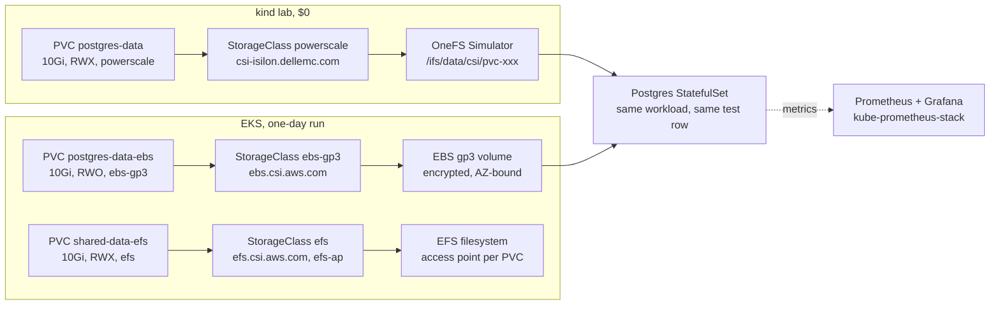

# PowerScale CSI on Kubernetes, with an EKS runtime

[](https://github.com/chanawh/pscale-csi-kubernetes/actions/workflows/ci.yml)

Project 2, after the NAS-to-AWS migration factory. Project 1
moved files off PowerScale into the cloud. This one gives
Kubernetes a real disk, first on PowerScale and now also on
AWS, and proves the data survives the things that kill pods.

Two runtimes, one project:

- **kind + PowerScale CSI ($0).** Postgres runs on a
  PowerScale PVC via Dell's CSI driver against the OneFS
  Simulator. Four drills: snapshot and restore, clone,
  volume expansion 10 to 20 GiB, and killing a worker node
  to show the volume follows the pod.
- **EKS + AWS CSI (about $4.50 for one day).** The same
  Postgres workload on a real EKS cluster built with
  Terraform: EBS gp3 (block, ReadWriteOnce), EFS (file,
  ReadWriteMany), EKS Pod Identity for the CSI controllers,
  and kube-prometheus-stack observability. Drills: EBS
  snapshot and restore, expand 10 to 20 GiB, and a timed
  node drain that measures pod recovery instead of
  estimating it.

**Honest limits, up front:** we use Dell's driver and AWS's
drivers, we do not write any. The kind cluster's storage is
a Simulator. The EKS Terraform is validated (fmt/validate,
40 Python tests, Helm renders), not yet applied from this
build environment, which has no AWS account and no Docker;
kind runs in CI and on your machine, and the EKS run is a
one-day operator run, destroyed the same day. This is a lab
project, labelled as one. The point is that the same
workload runs against three storage systems and the drills
prove what survives.

## Reviewer path (5 minutes)

1. **Results** — the "Verified live" section below: the
   measured drill numbers and what the guard's tests prove.
2. **The guard** — `docs/GUARD_DESIGN.md`: why the taint,
   why not force-delete, the three conditions.
3. **The comparisons** — `docs/MEDIK8S_COMPARISON.md`
   (guard vs Self Node Remediation) and
   `docs/CNPG_COMPARISON.md` (StatefulSet vs CloudNativePG).
4. **The game days** — `docs/FIS_AZ_GAMEDAY.md` and
   `docs/DR_REGION.md`: written, unrun, with the runbooks
   and the cost model in `docs/COST.md`.
5. **The evidence** — `evidence/node-failure-drill.json`
   (the measured drill) and the CI logs linked from it.

| Metric | Result | Evidence |
|---|---|---|
| Drain, kind + NFS | serving in 5s (run 3; 10s in run 1) | `evidence/node-failure-drill.json`, run 45339015253 |
| Hard kill, no intervention | stalled 240s, pod Running/NotReady, no replacement | same evidence file |
| Hard kill + out-of-service taint | serving in 198s from kill (~15s from taint) | same evidence file |
| Guard unit tests | 15/15 pass (full decision matrix, fake client) | `python/tests/test_guard.py` |
| Guard false-positive test | wired into the drill workflow; not run yet (next manual dispatch) | `scripts/drills/guard_chaos_test.sh` |
| Guard live taint timing | unmeasured — drill built (`.github/workflows/guard-live-drill.yml`), pending push + manual dispatch | `scripts/drills/guard_live_ci.sh`, `evidence/guard-live.json` |
| Guard refusal trials (live node) | unmeasured — same drill, 3 trials on a paused node the guard must refuse | `scripts/drills/guard_live_ci.sh` |
| CNPG failover vs StatefulSet + guard | unmeasured — runbook written, pending a CI kind run | `docs/CNPG_COMPARISON.md` |
| FIS AZ game day, cross-region DR | unrun — Terraform validated, runbooks written, need EKS | `docs/FIS_AZ_GAMEDAY.md`, `docs/DR_REGION.md` |
| Burn-rate alerts | 2 multi-window alerts + 2 dashboard panels, validated by tests, never fired live | `monitoring/` |



## Who built this, and why

Andrew Chan, Technical Support Engineer II at Dell
Technologies since December 2018, escalation point for
150+ enterprise Dell PowerScale (OneFS) environments and
1,400+ high-severity incidents, with 15+ Python, Bash and
PowerShell automation tools and 20+ runbooks built on the
job. Certifications held: AWS Solutions Architect
Professional, CKA, Terraform Associate, RHCE, CCNA.

This project exists because support work alone does not
prove build skill. It takes the storage a PowerScale TSE
supports every day, NFS exports, SmartQuotas, snapshots,
node failures, puts Kubernetes on top of it with Dell's own
CSI driver, then runs the same workload on EKS with AWS's
CSI drivers so the comparison is measured, not asserted.
Target roles: Cloud Support Engineer, Cloud Operations,
Storage and Platform Engineer.

## What this proves for a cloud role

| PowerScale TSE experience | Cloud proof in this repo |
|---|---|
| NFS exports on OneFS | CSI node plugin mounts NFS exports on every worker; EFS access points on EKS |
| SmartQuotas | Driver sets a quota per volume, expansion grows it in place; EBS expansion via resizer on EKS |
| PowerScale snapshots | CSI VolumeSnapshot, restore PVC, clone PVC; EBS snapshot/restore on EKS |
| Node failure on a cluster | kind drill: drain (graceful reschedule, timed) and hard stop recovered with the out-of-service taint; a hard stop alone stalls a StatefulSet pod with no replacement (pod Running/NotReady, not Terminating — see `docs/NODE_FAILURE_DRILL.md`). CI runs the three cases on kind + NFS (`.github/workflows/node-failure-drill.yml`). A guard now automates the taint (`docs/GUARD_DESIGN.md`), with a false-positive chaos test in the drill workflow |
| OneFS Platform API | CSI controller creates directories, exports, quotas through the API |
| CKA, Kubernetes operations | kind cluster, Helm installs, StorageClasses, StatefulSet, CI dry-run in a real cluster |
| AWS Solutions Architect Professional | EKS cluster + node group in Terraform, EBS/EFS CSI addons, Pod Identity least-privilege roles, KMS secrets encryption, CloudWatch control-plane logs |
| Observability (exporter work) | kube-prometheus-stack on EKS: node, kube-state, PVC/pod metrics during the drills |

**For hiring managers and interviewers:** start at
`docs/INTERVIEW_GUIDE.md`. It has the STAR bullets, the
30-second pitch, and the questions you will be asked, with
answers. CI runs on every push: 40 Python tests, Terraform
fmt/validate (both roots), Helm template, IaC scanning
(tflint + checkov), and a real kind cluster where the
manifests are applied dry-run, see
`.github/workflows/ci.yml`. The node-failure numbers come
from `.github/workflows/node-failure-drill.yml`, which runs
the three cases (drain / hard-stop stall / hard-stop +
out-of-service taint) on kind + NFS — not from the
PowerScale path, which has no live cluster run yet.
Measured 24 Nov 2026 (run 45339015253, kind v0.31.0,
evidence in `evidence/node-failure-drill.json`):
drain recovered in 2s to Ready / 5s to serving queries;
hard stop with no intervention stalled (pod Running,
not Ready, after 240s) and recovered in place when
the node restarted; hard stop + out-of-service taint
recovered in 195s to Ready / 198s to serving, most of
it the node sitting in Unknown while the NotReady
flag lagged — the taint itself recovered the pod in
~15s once applied.

## What is in here

| Path | What it is |
|---|---|
| `k8s/` | PowerScale path: StorageClass x2, VolumeSnapshotClass, PVC, Postgres StatefulSet + Service + Secret, snapshot, restore PVC, clone PVC, test Job |
| `k8s/eks/` | EKS path: EBS gp3 + EFS StorageClasses, EBS snapshot class, EBS Postgres PVC + StatefulSet, EFS shared PVC, EBS snapshot + restore |
| `helm/` | Values for dell/csi-isilon 2.18.1, kube-prometheus-stack observability values, plus isilon-creds.yaml.example (never commit the filled-in file) |
| `terraform/` | EKS cluster + node group + EBS/EFS CSI addons + Pod Identity + EFS filesystem + KMS, gated off by `enable_eks = false` |
| `scripts/` | kind path: setup_kind, install_driver, run_demo, and 4 standalone drills |
| `scripts/eks/` | EKS path: deploy_eks (apply + addons + manifests + observability), run_eks_demo (timed drills), destroy_eks (PVCs first, then destroy, orphan check) |
| `python/tests/` | 40 checks on the manifests, Helm values, Terraform, scripts, monitoring, and the guard, no cluster needed |
| `guard/` | Node-down guard: stdlib Python, applies the out-of-service taint only when the node is unreachable AND a second source confirms the instance is down AND no maintenance annotation is set; dry-run, JSON-lines audit, auto-removal |
| `k8s/guard/` | Guard CronJob (every 2 min, in-cluster API client, AWS checker) + RBAC (patch nodes only) + ConfigMap with the script (generated, drift-tested) |
| `k8s/cnpg/` | CloudNativePG 2-replica Cluster manifest for the HA comparison (kind + NFS first; EKS swaps the class to ebs-gp3) |
| `terraform/fis/` | FIS AZ-loss experiment template (SSM Resilience Hub document) + DIY JSON alternative, validated, never applied |
| `monitoring/` | Grafana dashboard (10 panels) + PrometheusRule (7 alerts, incl. 2 multi-window burn-rate alerts) as code, validated in CI, loaded on the EKS run |
| `docs/GUARD_DESIGN.md` | Guard decision record: why taint, why not force-delete, the three conditions, what is still unmeasured |
| `docs/MEDIK8S_COMPARISON.md` | Guard vs medik8s Self Node Remediation vs Machine Deletion Remediation |
| `docs/CNPG_COMPARISON.md` | StatefulSet + guard vs CloudNativePG, with the failover runbook |
| `docs/FIS_AZ_GAMEDAY.md` | FIS AZ-loss game day runbook, stop conditions, rollback |
| `docs/DR_REGION.md` | Cross-region DR: snapshot copy, restore, RPO/RTO procedure |
| `docs/COST.md` | Cost model from list prices (EKS day, FIS, DR, guard, CNPG); no real spend yet |
| `docs/ONEFS_CSI_SETUP.md` | OneFS side: base path, SmartQuotas, NFS, networking |
| `docs/INTERVIEW_GUIDE.md` | STAR bullets, 30-second pitch, interview Q&As |
| `docs/REAL_EKS_ONE_DAY.md` | One real EKS run, about $4.50 for a day, step by step with destroy checklist |

**System design:** `docs/SYSTEM_DESIGN.md` covers
requirements, scale and capacity, the data model,
failure modes, security, observability, cost, tradeoffs,
and what to do next at real scale. `docs/adr/` holds the
six architecture decisions, each with context, decision,
and consequences. `SECURITY.md` states what is safe and
what is lab-only. That is the 2026-competitive part: not
just manifests that apply, but a design a reviewer can
argue with, and evidence that the argument was thought through.

## Run it: kind + PowerScale ($0)

```sh
# 1. OneFS: follow docs/ONEFS_CSI_SETUP.md, then fill in helm/isilon-creds.yaml
# 2. Cluster
bash scripts/setup_kind.sh
# 3. Driver (Dell's, installed with Helm)
bash scripts/install_driver.sh
# 4. Full demo
bash scripts/run_demo.sh
```

## Run it: EKS + AWS CSI (one day, then destroy)

```sh
# Requires: aws CLI configured, terraform, kubectl, helm, envsubst
bash scripts/eks/deploy_eks.sh    # Terraform apply, addons, manifests, observability
bash scripts/eks/run_eks_demo.sh  # write row, snapshot, expand, timed node drain, verify
bash scripts/eks/destroy_eks.sh   # PVCs first, then terraform destroy, orphan check
```

Full walkthrough, cost table, and evidence checklist:
`docs/REAL_EKS_ONE_DAY.md`.

## The drills

PowerScale path (kind):

1. **Snapshot and restore.** `scripts/drills/snapshot_restore.sh` snapshots the Postgres PVC, restores a new PVC from it, and proves the test row is back.
2. **Clone.** `scripts/drills/clone.sh` creates a second, independent PVC from the original, for testing without touching it.
3. **Expand.** `scripts/drills/expand.sh` grows the PVC from 10 to 20 GiB in place, no recreate, because `allowVolumeExpansion: true` is set on the StorageClass.
4. **Node failure.** `scripts/drills/node_failure.sh` stops the kind node running Postgres with `docker kill`, waits for NotReady and eviction start, applies the out-of-service taint (a hard stop alone stalls the StatefulSet pod with no replacement — see `docs/NODE_FAILURE_DRILL.md`), then times the pod rescheduling on the other worker and proves the row survived. The same three cases run in CI on kind + NFS (`scripts/drills/node_failure_ci.sh`, `.github/workflows/node-failure-drill.yml`). The PowerScale path runs on your machine only — see `docs/POWERSCALE_DRILL_RUNBOOK.md`. The guard (`guard/node_guard.py`, `docs/GUARD_DESIGN.md`) automates the taint with a second-source check; its false-positive test runs in the drill workflow before the cases start.

EKS path (`scripts/eks/run_eks_demo.sh`): write the row,
EBS snapshot and restore, expand 10 to 20 GiB, then
`kubectl drain` (graceful — the kubelet is alive) the
Postgres node and time how long the pod takes to be Ready
on the surviving node. That measured drain number replaces
any estimate for graceful rescheduling; it is not a hard
failure number. The row must read back after every step,
same as on PowerScale.

## Verified live

- Python tests: 40/40 pass (9 PowerScale + 8 EKS upgrade + 2 monitoring + 1 tolerations + 15 guard + 5 ceiling)
- Terraform fmt and validate: clean (EKS, addons, Pod Identity, EFS, KMS; FIS module)
- Helm template, dell/csi-isilon 2.18.1: renders 18 objects, driver name `csi-isilon.dellemc.com` present; kube-prometheus-stack with `helm/observability-values.yaml`: renders 113 objects
- Scripts: `bash -n` clean, including `scripts/eks/` and `scripts/drills/guard_chaos_test.sh`
- Guard: unit tests 15/15 + live run against fake kubectl/docker (dry-run would-taint, live mode issued exactly the taint + marker calls); false-positive chaos test wired into the drill workflow, not run yet
- Not run live here: kind (no Docker in this VM), the driver installs, Postgres, the drills, the guard's live taint timing, CNPG failover, FIS, DR, or any EKS apply (no AWS account in this VM). Those run on your machine (kind + OneFS Simulator), in CI on manual dispatch (drill workflow), and on your AWS account for one day (EKS). In CI the manifests are applied dry-run against a real kind API server.
