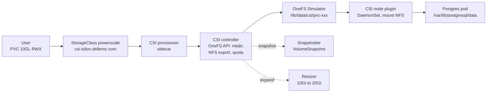

# System design: PowerScale CSI on Kubernetes

## 1. Problem

Kubernetes pods lose their data when they die or move
nodes. Give them a real disk on PowerScale, so a Postgres
pod can be killed, rescheduled, snapshotted, cloned, and
expanded, and its data survives all of it.

## 2. Requirements

Functional:
- Dynamic provisioning: a PVC creates a volume on OneFS.
- ReadWriteMany: many pods can mount the same volume.
- Snapshot and restore, clone, and in-place expansion.
- Node failure: the pod reschedules on another worker
  with the same volume reattached.

Non-functional:
- Integrity over speed: quotas enforce PVC size, or a
  volume can grow past it and fill OneFS.
- Operability: one command creates the cluster, one
  installs the driver, one runs the whole demo.
- Cost: $0 on kind, about $4.50 for a one-day EKS run.
- Portability: the same manifests run on kind and on EKS.

## 3. Architecture

The controller is central and talks to OneFS. The node
plugin runs on every worker and mounts NFS. The sidecars
are Kubernetes-supplied: provisioner, attacher,
snapshotter, resizer, registrar, and health monitor.

## 4. Scale and capacity

| Dimension | Design target | Lab | What breaks first at target |
|---|---|---|---|
| Volumes | 10s of PVCs, 1 cluster | 1 Postgres PVC, 10 GiB | One driver instance per cluster, NFS export count on OneFS |
| Volume size | 10-20 GiB per PVC | 10 GiB, expanded to 20 GiB | SmartQuota per volume, OneFS capacity |
| Pods per volume | ReadWriteMany, many readers | 1 Postgres replica | NFS locking, not the driver; Postgres itself is single-writer |
| Nodes | 2 workers, so a failure has somewhere to go | kind, 2 workers | kind is a lab, not a production topology |
| Throughput | NFS over the host LAN, ~1 Gb/s in the lab | Local, unmeasured | Network to OneFS, not the CSI driver |

NFS is the bottleneck and the feature at once: it gives
ReadWriteMany, which block storage cannot, and it caps
throughput at the network, not at the disk. At real scale
the answer is SmartConnect for load balancing across
OneFS nodes, and a dedicated storage network, not a
faster driver.

## 5. Data model

- StorageClass: provisioner `csi-isilon.dellemc.com`,
  `AccessZone: System`, `IsiPath: /ifs/data/csi`,
  `ClusterName: nas2aws-onefs`, `allowVolumeExpansion: true`,
  `volumeBindingMode: WaitForFirstConsumer`.
- PVC: 10 GiB, ReadWriteMany, `storageClassName: powerscale`.
- PV: created by the driver, pointing at the NFS export
  for `/ifs/data/csi/pvc-xxx`.
- VolumeSnapshot: `VolumeSnapshotClass: powerscale-snapclass`,
  same `IsiPath` as the StorageClass, or the driver cannot
  find the source.
- Clone and restore are PVCs with a `dataSource`, a
  VolumeSnapshot or a PVC, not copies made by hand.

## 6. Failure modes

| Failure | Detection | Behaviour |
|---|---|---|
| Pod dies | Kubernetes reschedules it | Node plugin on the new worker mounts the same NFS export, data is still there |
| Worker node dies | Node failure drill, `docker stop` | Pod reschedules on the other worker, same volume reattached |
| Volume fills up | SmartQuota, if enabled | Writes fail at the quota, not when OneFS fills. Without quotas, nothing stops it |
| OneFS unreachable | Driver probe on start, node labels missing | Controller pods fail to probe, PVCs stay Pending, never silently mount the wrong storage |
| Snapshot class IsiPath mismatched | Snapshot stays not readyToUse | Restore PVC cannot be created; fix the class, do not force it |
| Driver secret missing | Controller crash-loops | Install script creates the secret before Helm install, or the driver has no credentials to start with |

## 7. Security

- The driver needs OneFS credentials. They live in a
  Kubernetes Secret, `isilon-creds`, created from
  `helm/isilon-creds.yaml`, which is never committed.
  The example file holds `CHANGE-ME`, not a password.
- `skipCertificateValidation: true` is lab-only, because
  the Simulator uses a self-signed cert. On a real
  cluster, set it false and provide `isilon-cert-0`.
- The Postgres password in `k8s/postgres-secret.yaml`
  is `postgres`, a lab placeholder, stated as such.
- The driver runs with the permissions it needs to
  create directories, exports, and quotas on OneFS,
  and no more. It does not need cluster-admin on
  Kubernetes beyond what the Helm chart grants.

## 8. Observability

- Driver metrics: podmon exposes array status and
  metrics on port 8444, and the driver exposes a
  metrics endpoint for Prometheus scraping.
- Kubernetes events: `kubectl get events -n csi-demo`
  shows provisioning, attach, mount, snapshot, and
  expand, in order, which is the first place to look
  when a PVC stays Pending.
- The test Job writes a row, `csi-powerscale-proof`,
  and reads it back after every drill. That row is the
  proof, not a log line saying "success".

## 9. Cost

kind: $0. EKS, one day: about $4.50, control plane
~$2.40, 2 x t3.medium ~$2.00. Left running for a month:
~$135/month. See `docs/REAL_EKS_ONE_DAY.md`. The
OneFS Simulator is free for non-production use.

## 10. Tradeoffs, and what was not chosen

- Use Dell's driver, do not write one: writing a CSI
  driver is months of gRPC work and is not the job.
  See ADR-0001.
- NFS ReadWriteMany, not block ReadWriteOnce: NFS is
  what PowerScale gives you, and RWX is the feature.
  See ADR-0002.
- kind lab, EKS gated: $0 to build and test, real
  EKS for one day to prove it. See ADR-0003.
- Quotas on: without them, a volume can grow past
  its PVC size. See ADR-0004.
- Postgres single replica, not clustered: the point
  is the storage, not HA Postgres. See ADR-0005.

## 11. What I would do next at real scale

Two controller replicas, a real TLS cert, a dedicated
driver service account instead of root, SmartConnect
for load-balanced NFS, a dedicated storage network,
and CSI replication for multi-cluster disaster recovery.
None of those are in the lab, and none are claimed to be.
